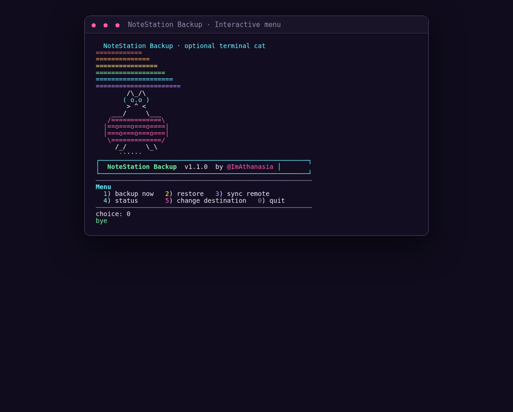
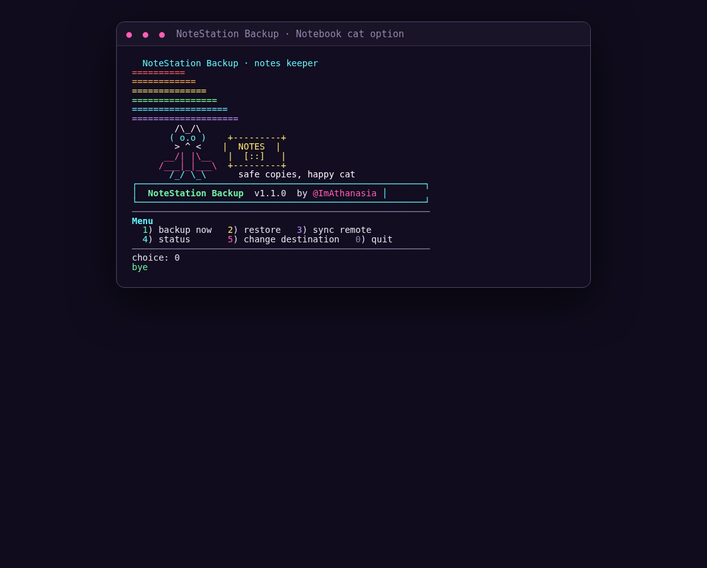
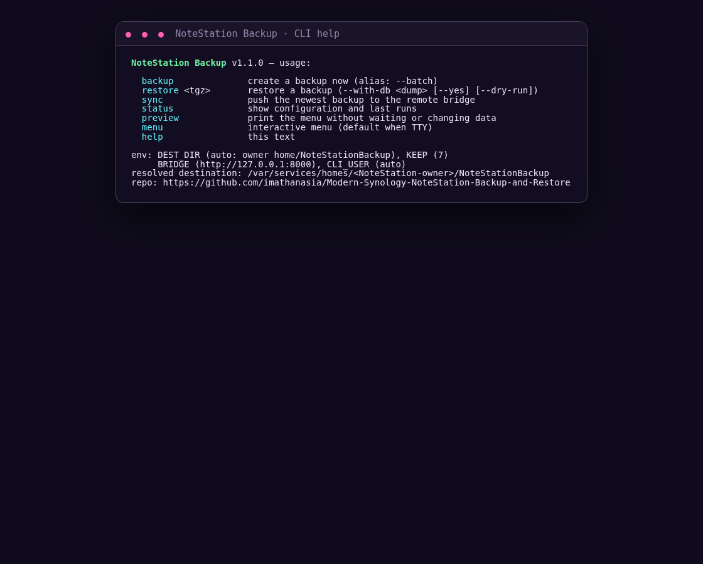

# Modern Synology NoteStation Backup and Restore

**Project and packaging: [@ImAthanasia](https://github.com/ImAthanasia).**

Interactive / batch backup, restore and remote-sync tool for **Synology Note Station**.

## What it does

- **Backup** — packs the NoteStation content tree (`/volume1/@SynoDrive/NoteStation`)
  into a `.tgz`, dumps the PostgreSQL index (`pg_dump -Fc`), and snapshots the note list
  via the official CLI (`synonsnote --list requester=<uid>`). Verifies the archive with
  `gzip -t` and keeps the newest `KEEP=7` artifacts per family.
- **Restore** — staged, dry-run-first restore: stops NoteStation, extracts to a stage
  dir, swaps content (keeping `.NoteStation.pre-restore.<stamp>`), optionally restores
  the PostgreSQL dump (`--with-db`), reindexes with `synonsconvert --index`, restarts.
  Rolls back automatically if the swap fails.
- **Sync** — pushes the newest archive to a remote HTTP endpoint
  (`POST /upload/<name>`) so a NAS failure does not take the backups with it.

## Preview







The playful ASCII cat is optional; preview it with
`AVATAR_FILE=./avatar-nyan.ansi sh ./notes-backup.sh preview`.
The notebook-carrying cat is available as `avatar-notebook.ansi`.
Three no-cat options are also included: `avatar-notebook-plain.ansi` (spiral
notebook), `avatar-notes-stack.ansi` (stacked note cards), and
`avatar-archive.ansi` (archive folder).

## Install (on the Synology)

```sh
# copy notes-backup.sh + avatar.ansi (+ optional avatar-nyan.ansi/avatar-notebook.ansi) into a folder in your home
chmod +x notes-backup.sh
sh notes-backup.sh            # interactive menu
```

## CLI

```sh
sh notes-backup.sh backup                 # backup now (alias: --batch)
sh notes-backup.sh restore <tgz>          # guided restore (asks first)
sh notes-backup.sh restore <tgz> --dry-run
sh notes-backup.sh restore <tgz> --with-db <dump> --yes
sh notes-backup.sh sync                   # push newest backup to the bridge
sh notes-backup.sh status                 # config + last runs
sh notes-backup.sh preview                # show menu, exit without waiting or changing data
sh notes-backup.sh help
```

To preview the optional cat banner in an interactive terminal:

```sh
AVATAR_FILE=/path/to/avatar-nyan.ansi sh /path/to/notes-backup.sh menu
```

## Daily schedule

DSM → **Control Panel → Task Scheduler → Create → Scheduled Task → User-defined script**
(run as `root`, daily; update the tool path to where you installed it):

```sh
sh /path/to/notes-backup.sh backup
```

## Remote sync tip

Keep the destination folder inside a share mirrored by **Synology Drive**, or use
`notes-backup.sh sync`. A backup that only lives on the NAS dies with the NAS.

## Configuration

| Env var | Default | Meaning |
|---|---|---|
| `DEST_DIR` | NoteStation owner's home + `/NoteStationBackup` | Where archives are written; configure explicitly if DSM User Home is disabled |
| `KEEP` | `7` | Retention count per artifact family |
| `BRIDGE` | `http://127.0.0.1:8000` | Remote sync endpoint; configure for your server |
| `CLI_USER` | auto-detected | NoteStation requester uid; override if detection is ambiguous |
| `AVATAR_FILE` | `./avatar.ansi` | ANSI avatar banner shown at startup |

## Error handling

`preflight` checks the content dir, CLI tools and destination writability; each step
reports and logs; the archive is verified before it is kept; restore is staged with
rollback; every run appends to `last_backup.log` and returns a nonzero exit code on
hard failure (so Task Scheduler can flag it).

The default destination is resolved from the owner of the NoteStation content objects
under `/var/services/homes/<owner>/NoteStationBackup` (falling back to
`/volume1/homes/<owner>/NoteStationBackup`). Synology documents local-user home folders
under `/volume1/homes/<account>` when User Home service is enabled; the volume can vary.
See [Synology User Home service](https://kb.synology.com/en-us/DSM/tutorial/user_enable_home_service)
and [My Drive / homes paths](https://kb.synology.com/en-global/DSM/tutorial/Drive_difference_between_homes_My_Drive_home_folders).

## Layout

```
notes-backup.sh      backup / restore / sync / status / menu (single entry point)
restore-notes.sh     thin compatibility wrapper → notes-backup.sh restore
avatar.ansi          truecolor GitHub avatar banner
avatar-nyan.ansi     optional playful ASCII cat banner
avatar-notebook.ansi optional cat-with-notebook banner
avatar-notebook-plain.ansi optional spiral notebook banner (no cat)
avatar-notes-stack.ansi    optional stacked note cards (no cat)
avatar-archive.ansi        optional archive folder (no cat)
tools/make-avatar.py avatar → ANSI renderer (Pillow)
tools/make-nyan-banner.py optional ASCII cat banner generator
tools/make-notebook-cat.py optional notebook-cat banner generator
tools/make-notebook-art.py generator for three no-cat banners
tools/build-art-gallery.py builds a local terminal-art preview page
tools/render-cli-screenshots.py headless Chromium screenshot generator
docs/architecture.md sanitized architecture findings
```

## License

MIT — see [LICENSE](LICENSE).
